# Sakina

A calm, premium Dhikr and Tasbih counter for Android and iOS, built with Flutter.

Sakina offers two complete counting experiences:

- **Bead Tasbih**: a realistic, procedurally rendered prayer-bead loop. Beads glide one at a
  time through a gap, the way a real tasbih passes between the fingers. It includes an imam bead
  with a tassel, spacer beads on the 99-bead tasbih, and ten materials (walnut, sandalwood,
  ebony, onyx, turquoise, amethyst, marble, jade, pearl, amber) with custom tints.
- **Digital Counter**: a minimal counter with rolling digits, available in three layouts (Ring,
  Classic, and a handheld Device with an LCD seven-segment display) and six designs plus custom
  colors.

Everything works offline. There are no accounts, no analytics, and no network requests.

| Home | Ring, walnut | Strand, turquoise | 99 beads, amethyst |
| --- | --- | --- | --- |
| 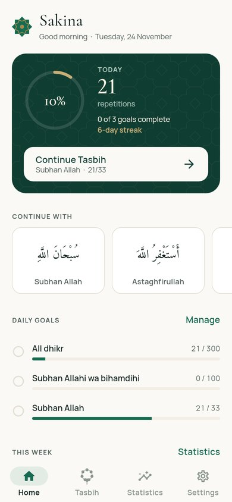 | 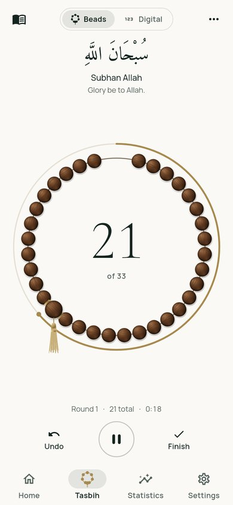 | 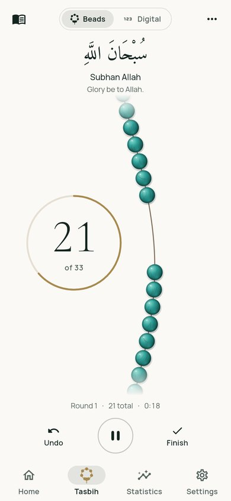 | 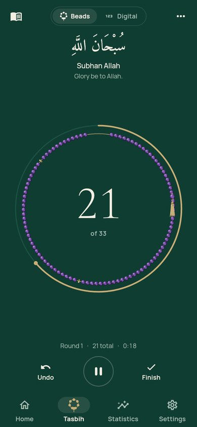 |

| Digital, ring | Digital, classic | Digital, device | Goal reached |
| --- | --- | --- | --- |
| 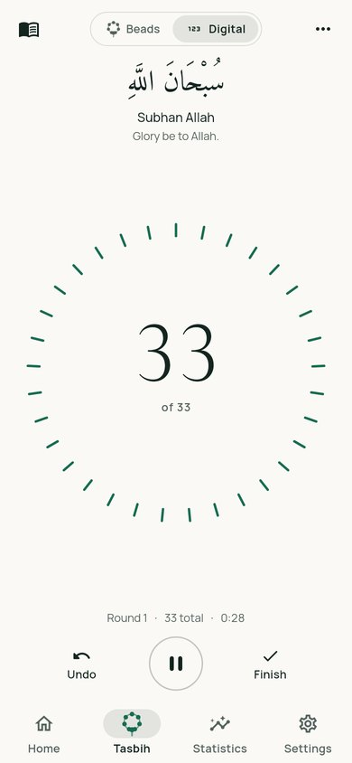 | 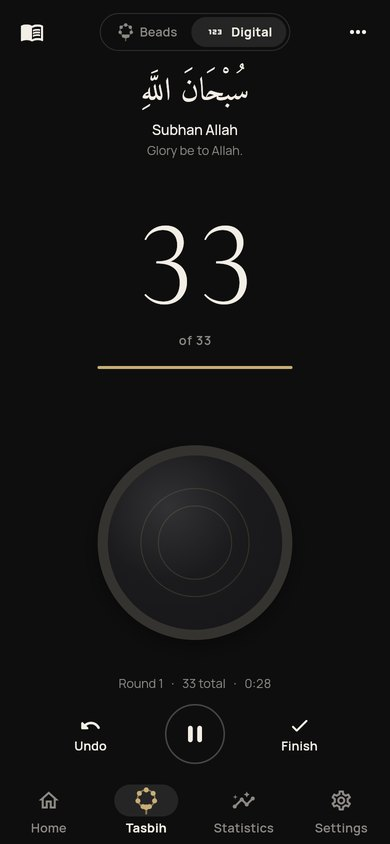 | 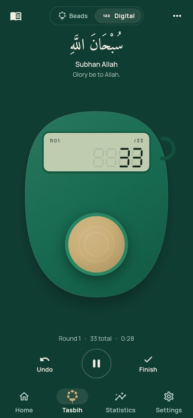 | 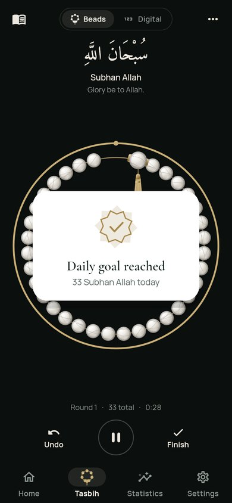 |

| Statistics | Library | Customize | Home, dark |
| --- | --- | --- | --- |
| 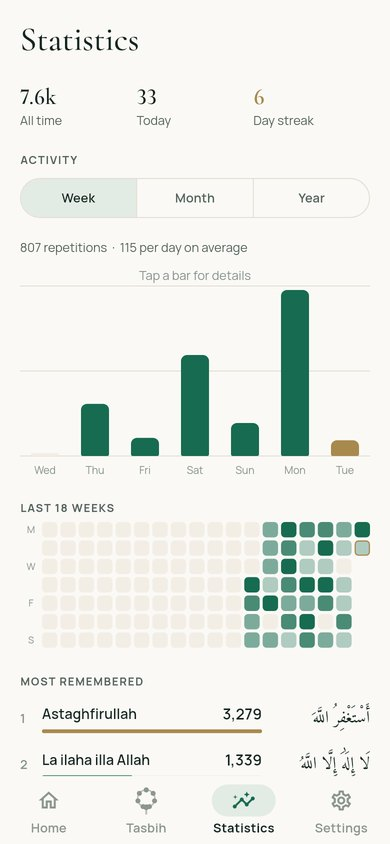 | 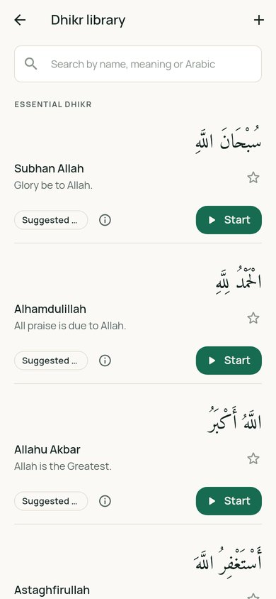 | 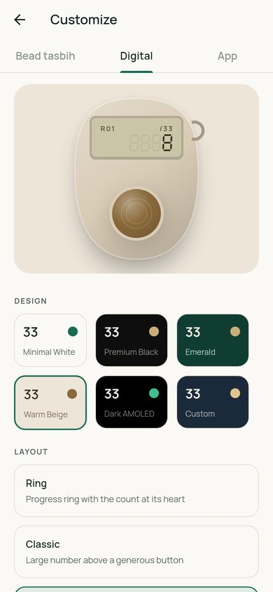 | 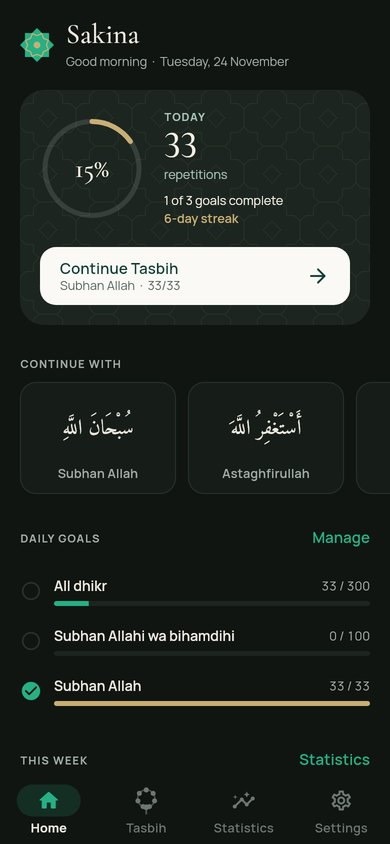 |

## Features

**Counting**
- Tap anywhere on the counter. On the bead tasbih you can also pull beads along the strand or
  turn the ring with your thumb.
- Rounds complete automatically, with a distinct haptic, an optional chime, and a short animation.
- Undo, pause and resume. While paused, a tap resumes the counter instead of counting, so a stray
  touch never adds a repetition.
- A double-count guard rejects input that arrives faster than a deliberate tap (70 ms), such as
  touch bounce, two fingers landing together, or a tap and a drag recognized for the same gesture.
- The session is saved to SQLite on every count, so it survives restarts and the OS killing the
  app.
- Session time is *active* time: idle gaps over 60 seconds are not counted.
- Reset asks for confirmation and offers to save the count to history or discard it completely.

**Dhikr library**
- Eight essential dhikr with Arabic (Amiri, right-to-left), transliteration and translation.
- Suggested numbers appear only where a well-known narration mentions one, and always come with
  the source. Otherwise the app shows "No fixed number" and the user chooses.
- Create, edit, delete and favourite your own dhikr, with a live preview while editing.

**Statistics and history**
- Totals for all time and today, current and longest streaks, activity charts by week, month and
  year (tap a bar for details), an 18-week heatmap, and the most remembered dhikr.
- Personal records: best day, longest streak, longest session, longest focus time, completed
  sessions, rounds, total focused time, and active days.
- History grouped by day, with repetitions, rounds, duration and time. Delete an entry by swiping
  or with its delete button, after confirmation.
- Counts are stored per day, so a session that runs past midnight is attributed correctly.

**Goals and reminders**
- Daily goals for one dhikr or for all dhikr combined: 33, 99, 100, 1000 or a custom number.
- Reaching a goal while counting plays a celebration and a goal haptic.
- Optional weekly reminders: inexact scheduling with default importance (never intrusive).
  Tapping a reminder opens the tasbih, optionally with a chosen dhikr.

**Customization studio** (with live, animated previews)
- Bead style (Ring or Strand), material, tint (including a custom color picker), size, bead count
  (33 or 99), and background (Ivory, Linen, Geometric, Forest, Night).
- Digital design and layout, with custom background and accent colors.
- Light, dark or system theme. Accent color. Arabic and interface text sizes. Sound and
  vibration toggles.

## Getting started

Requires Flutter 3.50 or later (Dart 3.14). Material comes from the `material_ui` package, which
recent Flutter releases use in place of `flutter/material.dart`.

```bash
flutter pub get
```

```bash
flutter run
```

### Platform notes

- **Android**: core library desugaring is enabled for `flutter_local_notifications`. The manifest
  declares the scheduled-notification receivers, `POST_NOTIFICATIONS`, `RECEIVE_BOOT_COMPLETED` and
  `VIBRATE`. No exact-alarm permission is requested. Replace the debug signing config in
  `android/app/build.gradle.kts` before publishing.
- **iOS**: the app delegate sets the notification center delegate. Notification permission is only
  requested when the user enables a reminder.
- App icons (iOS and Android adaptive) are generated from the app's eight-pointed star emblem.

## Testing

```bash
flutter analyze
```

```bash
flutter test
```

The suite covers:

| Area | File |
| --- | --- |
| Counting rules (rounds, pause, undo, active time) | `test/unit/counter_session_test.dart` |
| Double-count guard | `test/unit/tap_guard_test.dart` |
| Bead loop layout (imam, separators, wrap-around, animation targets) | `test/unit/bead_loop_test.dart` |
| Streaks, goal progress, reminder masks, formatting | `test/unit/stats_and_goals_test.dart` |
| SQLite persistence (sessions, per-day counts, statistics, library, goals, reminders, settings) | `test/data/persistence_test.dart` |
| Tasbih controller (restart survival, events, goals, reset, switching, feedback) and reminder scheduling | `test/controller/tasbih_controller_test.dart` |
| End-to-end UI flows | `test/widget/app_flow_test.dart` |

Persistence tests run against the production schema using `sqflite_common_ffi` with an in-memory
database.

### Design screenshots

Every main screen can be rendered to PNG, with bundled fonts and seeded sample data, on a 390x844
phone and a 360x640 small phone:

```bash
SAKINA_SCREENSHOTS=1 flutter test test/screenshots
```

The images are written to `build/screenshots/`.

## Project structure

See [ARCHITECTURE.md](ARCHITECTURE.md) for layers, data flow and design decisions.

```
lib/
  core/        theme, router, database, platform services, providers, utils
  features/
    home/      dashboard
    tasbih/    counter domain, persistence, controller, bead and digital renderers
    dhikr/     library, seed data, editor
    statistics/ read models, charts, history
    goals/     daily goals
    reminders/ local notifications
    settings/  preferences, customization studio, about
  shared/      reusable widgets (progress ring, rolling number, color picker, patterns)
```

## Religious content

Sakina does not issue religious rulings. Suggested repetition numbers are limited to well-known
narrations in the major hadith collections and are shown together with their reference (for
example, Sahih Muslim 597 for 33 repetitions of tasbih, tahmid and takbir after the obligatory
prayers). Please consult a qualified scholar for guidance.

## Licenses

Fonts are bundled under the SIL Open Font License: Amiri (Arabic), Manrope (interface) and
Cormorant Garamond (numerals and headings). The license texts are in `assets/licenses/` and are
shown on the in-app licenses page. The sound effects were synthesized for this project.
